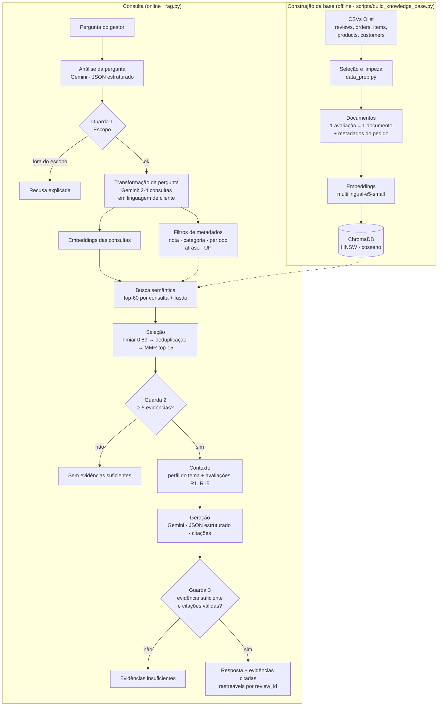

# Voice of Customer Intelligence com RAG

**Tech Challenge – Fase 4 · Pós-Tech IA Scientist (FIAP)** · RM371084

Solução de *Retrieval-Augmented Generation* (RAG) que transforma ~42 mil avaliações escritas por clientes da
[Olist](https://www.kaggle.com/datasets/olistbr/brazilian-ecommerce) em uma base de conhecimento explorável em
linguagem natural. Gestores e analistas fazem perguntas como *“quais são os principais problemas de entrega?”* e
recebem respostas **fundamentadas em avaliações reais, com citações rastreáveis** — e o sistema **se recusa a
responder** quando não há evidências suficientes.

---

## Sumário

1. [Problema de negócio](#1-problema-de-negócio)
2. [Arquitetura](#2-arquitetura)
3. [Tecnologias](#3-tecnologias)
4. [Construção da base de conhecimento](#4-construção-da-base-de-conhecimento)
5. [Pipeline RAG](#5-pipeline-rag)
6. [Respostas fundamentadas e rastreabilidade](#6-respostas-fundamentadas-e-rastreabilidade)
7. [Perguntas sem evidências suficientes](#7-perguntas-sem-evidências-suficientes)
8. [Desafio adicional: metadados e exploração contextual](#8-desafio-adicional-metadados-e-exploração-contextual)
9. [Exemplos de perguntas e respostas](#9-exemplos-de-perguntas-e-respostas)
10. [Avaliação](#10-avaliação)
11. [Instalação e execução](#11-instalação-e-execução)
12. [Estrutura do repositório](#12-estrutura-do-repositório)
13. [Decisões técnicas, limitações e próximos passos](#13-decisões-técnicas-limitações-e-próximos-passos)

---

## 1. Problema de negócio

Empresas de e-commerce recebem milhares de avaliações por dia. As notas (1–5) mostram **quanto** o cliente está
satisfeito, mas o **porquê** — atrasos, produtos danificados, vendedores que não respondem, elogios à embalagem — está
nos comentários em texto livre, e ler milhares deles manualmente não escala.

O objetivo é permitir que gestores perguntem, em linguagem natural:

* Quais são os principais problemas relatados pelos clientes?
* Quais reclamações relacionadas à entrega aparecem com maior frequência?
* O que os clientes mais elogiam?
* Quais avaliações sustentam determinado insight?

…e recebam respostas **sustentadas por avaliações reais**, com as evidências visíveis — sem respostas
“convincentes” inventadas.

## 2. Arquitetura



| Módulo | Responsabilidade |
|---|---|
| [`src/vocrag/config.py`](src/vocrag/config.py) | Caminhos, modelos e hiperparâmetros (limiar, top-k, MMR) |
| [`src/vocrag/data_prep.py`](src/vocrag/data_prep.py) | Seleção, limpeza, tratamento de ausentes, *joins* de metadados, documentos |
| [`src/vocrag/indexing.py`](src/vocrag/indexing.py) | Embeddings (E5) e indexação no ChromaDB |
| [`src/vocrag/retrieval.py`](src/vocrag/retrieval.py) | Busca multi-consulta, fusão, limiar, deduplicação, MMR, perfil do tema |
| [`src/vocrag/filters.py`](src/vocrag/filters.py) | Desafio adicional: filtros de metadados, validação e conversão para `where` |
| [`src/vocrag/llm.py`](src/vocrag/llm.py) | Prompts e chamadas ao Gemini com saída estruturada (Pydantic) |
| [`src/vocrag/rag.py`](src/vocrag/rag.py) | Orquestração do pipeline, contexto, guardas e validação de citações |
| [`src/vocrag/display.py`](src/vocrag/display.py) | Exibição das respostas e evidências nos notebooks |

## 3. Tecnologias

| Componente | Escolha | Por quê |
|---|---|---|
| Linguagem | Python 3.12+ (testado em 3.14) | Ecossistema de dados e IA |
| Dados | pandas, pyarrow | Preparação e armazenamento intermediário (Parquet) |
| Embeddings | `sentence-transformers` + [`intfloat/multilingual-e5-small`](https://huggingface.co/intfloat/multilingual-e5-small) | Multilíngue, bom em português, treinado para busca pergunta→passagem, roda local em CPU |
| Banco vetorial | [ChromaDB](https://www.trychroma.com/) (persistente) | Embutido (sem servidor), HNSW + cosseno, metadados filtráveis junto ao vetor |
| LLM | Google Gemini (`gemini-3.5-flash`, com modelos de reserva) via `google-genai` | Ótimo em português, saída JSON estruturada, plano gratuito; *fallback* automático em caso de cota esgotada ou sobrecarga |
| Validação de saída | Pydantic | Esquemas para a análise da pergunta e para a resposta |
| Interface | Jupyter Notebooks | Mostra o raciocínio de cada etapa e a demonstração |

## 4. Construção da base de conhecimento

Detalhes e gráficos em [`notebooks/01_construcao_base_conhecimento.ipynb`](notebooks/01_construcao_base_conhecimento.ipynb).

| Etapa | Estratégia | Justificativa |
|---|---|---|
| **Seleção** | Avaliações com título **ou** comentário informativo (42.706 → **41.960** documentos) | ~57% das avaliações não têm texto e não carregam “voz do cliente” recuperável |
| **Limpeza** | Normalização Unicode, remoção de `\r\n` e espaços extras, `!!!!!!`→`!!`; **sem** *lowercase*, *stemming* ou remoção de *stopwords* | Modelos *transformer* usam acentos, negações (“**não** chegou”) e pontuação como sinal semântico |
| **Ruído** | Descarte de textos sem letras ou com < 3 caracteres (`"."`, `"10"`) | Não têm significado recuperável |
| **Ausentes** | Título/comentário ausente → usa o outro campo; ambos ausentes → descarta. Categoria/UF/status ausentes → rótulo explícito (`sem_categoria`). Numéricos ausentes (ex.: atraso de pedido não entregue) → **omitidos** no índice | Não inventar valores que distorçam filtros e estatísticas |
| **Duplicidade** | 315 `review_id` repetidos (mesma avaliação ligada a pedidos diferentes) → 1 documento por avaliação | Evita evidências duplicadas |
| **Documento** | 1 avaliação = 1 documento, `título + comentário`, ID = `review_id`, **sem *chunking*** | Média de 12 palavras (máx. 48): cada avaliação já é uma unidade semântica completa e rastreável |
| **Metadados** | Nota, sentimento, data, status do pedido, dias de entrega, atraso vs. prazo estimado, categoria principal (item de maior valor), valor, frete, UF | Contexto para o LLM, métricas de avaliação e filtros (desafio adicional) |
| **Embeddings** | `multilingual-e5-small` com prefixos `passage:`/`query:`, vetores normalizados (384 dim.) | Busca assimétrica, leve (≈12 min para indexar tudo em CPU), sem custo por chamada |
| **Indexação** | ChromaDB persistente em `data/chroma`, HNSW com distância cosseno | Busca aproximada rápida + filtros por metadados na mesma consulta |

**Comentários idênticos** (“ótimo” aparece 607 vezes, “não recebi o produto” 114) são mantidos na base — são
clientes diferentes e contam para a frequência —, mas são deduplicados na hora de montar o contexto.

## 5. Pipeline RAG

Passo a passo com saídas reais em [`notebooks/02_pipeline_rag.ipynb`](notebooks/02_pipeline_rag.ipynb).

1. **Transformação da pergunta (Gemini).** Existe um descompasso de vocabulário: o gestor pergunta de forma abstrata
   (“problemas relacionados à entrega”), o cliente escreve de forma concreta (“até hoje não recebi meu pedido”).
   Uma única chamada com saída estruturada:
   (a) **classifica o tipo da pergunta** — `experiencia_do_cliente`, `dados_internos_da_empresa` ou `fora_do_dominio` —
   apenas pelo assunto; o LLM é instruído a **não** julgar se o tema existe na base (isso é papel da busca);
   (b) gera **2–4 consultas no estilo de uma avaliação**, cobrindo aspectos diferentes do tema (*multi-query*);
   (c) extrai **filtros de metadados** quando a pergunta pede um recorte explícito (seção 8).
   A pergunta original é sempre mantida entre as consultas.
2. **Embeddings das consultas** com o prefixo `query:`.
3. **Recuperação semântica.** Top-60 por consulta no ChromaDB; os resultados são **fundidos** (cada avaliação fica
   com a maior similaridade entre as consultas).
4. **Seleção dos conteúdos mais relevantes.**
   * **Limiar de similaridade = 0,89**, calibrado empiricamente: o E5 gera similaridades “comprimidas” (textos sem
     relação ficam em 0,82–0,88), então um limiar genérico não funcionaria. Consultas do domínio têm top-1 entre
     0,92 e 0,96 e centenas de avaliações acima de 0,89; consultas sobre temas ausentes (criptomoedas, Alexa,
     receitas) ficam com 0 a 5.
   * **Deduplicação** de textos idênticos, informando ao LLM quantas vezes o texto se repete.
   * **MMR** (*Maximal Marginal Relevance*, λ = 0,7) para escolher 15 avaliações **relevantes e diversas** — o
     contexto cobre vários aspectos do tema (não entregue, atraso, pedido incompleto, frete) em vez de 15 variações
     de “não chegou”.
5. **Construção do contexto.** Duas partes: um **perfil do tema** (quantas avaliações entre as 1.000 mais próximas
   passam do limiar, nota média, % de notas 1–2, % de atraso, categorias mais citadas) — que permite falar de
   **recorrência** sem inventar números — e as **avaliações numeradas** `[R1]…[R15]` com nota, categoria, data e atraso.
6. **Geração.** Gemini com instruções de sistema rígidas, temperatura 0,1 e **saída JSON** (`sufficient_evidence`,
   `answer`, `limitations`).
7. **Validação.** Citações extraídas da resposta são conferidas contra as evidências do contexto; IDs inexistentes
   são descartados e reportados.

## 6. Respostas fundamentadas e rastreabilidade

* O LLM só recebe as avaliações recuperadas e é instruído a **citar `[R#]` em cada afirmação**, sem usar
  conhecimento externo nem inventar números.
* Cada `R#` corresponde a uma avaliação real, identificada pelo `review_id` e exibida com nota, categoria, data,
  atraso e similaridade — o usuário vê **quais avaliações sustentam cada insight**.
* Os marcadores entre colchetes são extraídos da resposta (incluindo intervalos como `[R3-R5]`) e conferidos contra
  o contexto; marcadores inexistentes ou malformados (ex.: `[F11]`) são **descartados e reportados**.
* Uma resposta sem nenhuma citação válida é rebaixada para “evidências insuficientes”.

## 7. Perguntas sem evidências suficientes

Três guardas em camadas, cobrindo os três cenários do enunciado:

| Cenário | Guarda | Comportamento |
|---|---|---|
| Pergunta fora do escopo (“qual a capital da Austrália?”, “qual o faturamento da Olist?”) | Classificação do tipo da pergunta na transformação | Recusa explicada, sem busca nem geração |
| Não existem avaliações relevantes (“pagamento com criptomoedas”) | Menos de **5** avaliações acima do limiar de 0,89 | “Sem evidências suficientes”, **sem chamar o LLM** |
| Evidências recuperadas insuficientes | LLM marca `sufficient_evidence = false` **ou** resposta sem citações válidas | “Evidências insuficientes”, explicando o que foi e o que não foi encontrado |

## 8. Desafio adicional: metadados e exploração contextual

Detalhes e comparação em [`notebooks/04_metadados_exploracao_contextual.ipynb`](notebooks/04_metadados_exploracao_contextual.ipynb).

A busca semântica encontra avaliações **sobre** um tema, mas não sabe **de quem** ou **de quando** elas são — o
cliente raramente escreve a categoria do produto, a data ou a nota no comentário. Como os metadados já ficam
armazenados junto aos vetores, o pipeline foi estendido com **pré-filtragem por metadados**:

1. Na transformação da pergunta (mesma chamada ao LLM, sem custo extra), o Gemini extrai filtros **somente quando a
   pergunta pede um recorte explícito** ([`MetadataFilters`](src/vocrag/filters.py));
2. Os filtros são **validados** contra os valores reais da base (categorias e UFs inexistentes são descartadas,
   notas limitadas a 1–5, período no formato `AAAA-MM`) e convertidos em `where` do ChromaDB;
3. A busca vetorial, o perfil do tema e as evidências passam a considerar **apenas o recorte**, que também é
   informado ao LLM no contexto. O usuário pode ainda passar `where` diretamente em `rag.ask(...)`.

| Pergunta | Filtro extraído |
|---|---|
| Quais são os principais problemas relatados nas avaliações com **nota baixa**? | `review_score ≤ 2` |
| O que os clientes mais elogiam em produtos de **cama, mesa e banho**? | `review_score ≥ 4` e `product_category = cama_mesa_banho` |
| Quais temas aparecem nas avaliações de pedidos **entregues com atraso**? | `delivered_late = true` |
| O que os clientes relataram sobre a entrega em **maio e junho de 2018**? | `year_month ∈ {2018-05, 2018-06}` |
| O que os clientes relatam sobre problemas relacionados à entrega? | *(nenhum — tema geral fica com a busca)* |

**Como os metadados contribuem para a qualidade da recuperação:** sem filtros, a busca só consegue *aproximar* a
condição pelo texto (ex.: “nota baixa” vira reclamações em geral, inclusive de clientes que deram nota 3–4); com
filtros, **todas** as evidências atendem à condição, o perfil do tema é calculado no recorte certo e passam a ser
possíveis perguntas que o texto sozinho não responde (“elogios em uma categoria”, “reclamações em um mês”). As guardas
continuam valendo: um recorte pequeno demais resulta em “sem evidências”, não em uma resposta inventada.

## 9. Exemplos de perguntas e respostas

Respostas completas, com a tabela de evidências de cada uma, em
[`notebooks/03_demonstracao_e_avaliacao.ipynb`](notebooks/03_demonstracao_e_avaliacao.ipynb) e
[`notebooks/04_metadados_exploracao_contextual.ipynb`](notebooks/04_metadados_exploracao_contextual.ipynb).
Como o LLM tem alguma variação entre execuções, os textos abaixo são de uma execução específica.

### “O que os clientes relatam sobre problemas relacionados à entrega?”

**Consultas geradas:** *“o produto atrasou muito e não chegou no prazo”* · *“a transportadora demorou demais para
entregar meu pedido”* · *“tive problemas com a entrega e o rastreio não atualizava”*
**Perfil do tema:** ≥1.433 avaliações relacionadas · nota média 2,97 · 45,1% com nota 1–2

> * **Atrasos na entrega**: os produtos não chegam dentro do prazo, com atrasos de 2 a 21 dias após o vencimento
>   [R1, R2, R4, R5, R8, R10, R11]. Há relatos de produto não recebido mesmo após o término do prazo [R1, R7] …
> * **Falta de atendimento e suporte**: um cliente enviou e-mail sobre a entrega atrasada e não obteve retorno [R9].
> * **Incompletude do pedido**: dois pedidos com o mesmo rastreamento, apenas um recebido [R13].

| Ref. | Nota | Categoria | Data | Atraso (dias) | Avaliação |
|---|---|---|---|---|---|
| R1 | 1 | informatica_acessorios | 2018-06 | 7 | “entrega atrasada. o prazo terminou e nao recebi meu produto” |
| R4 | 2 | eletronicos | 2018-06 | 7 | “Atraso. Produto não chegou no prazo” |
| R7 | 1 | sem_categoria | 2016-10 | — (não entregue) | “PRODUTO NÃO CHEGOU,E JÁ PASSOU O PRAZO DE ENTREGA” |
| R9 | 1 | informatica_acessorios | 2018-02 | 5 | “O Produto esta com a ntrega atrasada, mesmo com o prazo de 1 mes para entrega. Enviei e-mail e tambem não obtive retorno…” |

### Outras perguntas do enunciado (resumo)

| Pergunta | Status | Principais insights (todos com citações) |
|---|---|---|
| Quais são os principais problemas relatados pelos clientes? | ✅ | Produto com defeito, quebrado, avariado, incompleto ou diferente do anúncio; atrasos e pedidos não entregues sem satisfação ao cliente |
| Quais aspectos da experiência de compra são mais elogiados? | ✅ | Entrega rápida e antes do prazo; qualidade que supera expectativas; atendimento excelente e atencioso |
| Quais padrões nas avaliações de clientes insatisfeitos? | ✅ | Filtro `nota ≤ 2` extraído da pergunta: produtos com defeito ou que não funcionam; atrasos (28,3% entregues após o prazo no recorte); embalagem suja ou produto solto na caixa |
| Quais avaliações sustentam problemas recorrentes de prazo? | ✅ | Avaliações sobre descumprimento de prazo, cancelamento por não entrega e demora na separação — e, separadas, as que relatam entrega no prazo (contraponto) |
| Existem padrões relacionados à qualidade dos produtos? | ✅ | Baixa qualidade/acabamento; defeitos e avarias; divergência do anúncio — e também elogios, separados |
| Problemas nas avaliações com **nota baixa** *(metadados)* | ✅ | Filtro `nota ≤ 2`: defeitos e itens faltando; atrasos; péssimo atendimento |
| Elogios em **cama, mesa e banho** *(metadados)* | ✅ | Filtro de categoria: tecido macio, toalhas e mantas de qualidade, entrega no prazo |

### Perguntas sem evidências / fora do escopo

| Pergunta | Status | Guarda que atuou |
|---|---|---|
| Qual é a capital da Austrália? | 🚫 Fora do escopo | 1 — classificada como `fora_do_dominio` |
| Qual foi o faturamento da Olist em 2018 e a margem de lucro? | 🚫 Fora do escopo | 1 — `dados_internos_da_empresa` |
| Clientes do Acre relatam que produtos de informática chegam quebrados? | ⚠️ Sem evidências | 2 — recorte com 5 avaliações, nenhuma acima do limiar; **LLM de geração não é chamado** |
| O que os clientes acham do pagamento com criptomoedas? | ⚠️ Evidências insuficientes | 3 — a busca trouxe avaliações genéricas (prazo, qualidade, compra); o LLM declarou que nenhuma trata de criptomoedas |
| O que os clientes falam sobre comprar pelo assistente de voz Alexa? | ⚠️ Evidências insuficientes | 3 — idem: nenhuma avaliação menciona Alexa ou comando de voz |

## 10. Avaliação

Não existe gabarito de “avaliações relevantes” por pergunta, então usamos **métricas proxy** com os metadados,
que **não** participam da busca (a recuperação é puramente semântica sobre o texto). Detalhes no notebook 03.

**Coerência das evidências com o tema da pergunta** (média das perguntas de cada grupo):

| Grupo de perguntas | Métrica | Com multi-query | Sem multi-query | Taxa na base |
|---|---|---|---|---|
| Problemas / insatisfação | % das evidências com nota 1–2 | **96,5%** | — (sem evidências) | 25,8% |
| Elogios | % das evidências com nota 4–5 | **100%** | 100% | 65,6% |
| Entrega | % de pedidos atrasados ou não entregues | **58,0%** | 40,0% | 13,5% |

**Fundamentação e cobertura** (8 perguntas de avaliação):

| Pipeline | Respondidas | Sem evidências | Evidências por resposta | % das evidências citadas | Citações inválidas |
|---|---|---|---|---|---|
| Com multi-query | **8** | 0 | 15 | **87,5%** | 0 |
| Sem multi-query | 2 | 6 | 10 | 20,0% | 0 |

**Metadados (desafio adicional)** — % das evidências que atendem à condição pedida na pergunta:

| Pergunta | Com filtros | Sem filtros |
|---|---|---|
| Problemas nas avaliações com nota baixa | 100% | 93% |
| Elogios em cama, mesa e banho | 100% | 7% |
| Temas em pedidos entregues com atraso | 100% | 60% |
| Entrega em maio e junho de 2018 | 100% | 0% *(sem filtro, o LLM declarou evidências insuficientes)* |

**Leitura dos resultados**

* A recuperação semântica encontra avaliações realmente ligadas ao tema: a coerência fica 2–4× acima da taxa da base.
* A **transformação da pergunta é essencial**: perguntas abstratas de gestores, sozinhas, não alcançam o limiar de
  relevância (6 de 8 ficaram sem evidências). Reescritas na linguagem do cliente, todas foram respondidas.
* As respostas citam quase todas as evidências do contexto e nenhuma citação inválida foi gerada.
* Os metadados tornam a recuperação **precisa no recorte**; sem eles, perguntas por categoria ou período ficam
  praticamente sem evidências adequadas.

## 11. Instalação e execução

**Pré-requisitos:** Python 3.12+ e uma chave gratuita do Gemini ([Google AI Studio](https://aistudio.google.com/apikey)).
A base é baixada automaticamente do Kaggle (não exige login).

```bash
git clone https://github.com/tainajulianotti/tech-challenge-fase4-rag.git
cd tech-challenge-fase4-rag
python -m venv .venv
.venv\Scripts\activate          # Linux/macOS: source .venv/bin/activate
pip install -r requirements.txt
```

Crie o arquivo `.env` a partir do exemplo e preencha a sua chave:

```bash
copy .env.example .env          # Linux/macOS: cp .env.example .env
```

Baixe a base e construa a base de conhecimento (≈12 min em CPU; o modelo de embeddings é baixado na primeira vez):

```bash
python scripts/download_data.py
python scripts/build_knowledge_base.py
```

Abra os notebooks na ordem:

```bash
jupyter notebook notebooks/
```

| Notebook | Conteúdo |
|---|---|
| `01_construcao_base_conhecimento.ipynb` | Análise exploratória, limpeza, documentos, embeddings e índice |
| `02_pipeline_rag.ipynb` | Cada etapa do RAG para uma pergunta real, calibração do limiar, MMR, contexto e geração |
| `03_demonstracao_e_avaliacao.ipynb` | Perguntas de negócio, casos sem evidência / fora do escopo e avaliação quantitativa |
| `04_metadados_exploracao_contextual.ipynb` | Desafio adicional: filtros por nota, categoria, período, atraso e UF |

Uso programático:

```python
import sys; sys.path.insert(0, "src")
from vocrag.rag import VoCRAG
rag = VoCRAG()
resp = rag.ask("O que os clientes relatam sobre problemas relacionados à entrega?")
print(resp.status, resp.answer)
resp.evidence_table()          # evidências citadas, com review_id, nota, categoria, data e similaridade

# recorte explícito por metadados (desafio adicional)
rag.ask("Quais são as principais reclamações?",
        where={"$and": [{"product_category": "informatica_acessorios"}, {"review_score": {"$lte": 2}}]})
```

**Reprodutibilidade:** dependências em `requirements.txt`; hiperparâmetros em `src/vocrag/config.py`; o modelo do
Gemini e o de embeddings podem ser trocados no `.env` (`GEMINI_MODEL`, `EMBEDDING_MODEL` — trocar o de embeddings
exige reconstruir o índice). Temperatura 0,1 reduz, mas não elimina, variações entre execuções do LLM.

**Plano gratuito do Gemini:** a cota e a disponibilidade variam ao longo do dia. Quando o modelo principal responde
429 (cota) ou 503 (sobrecarga), o sistema passa automaticamente para os modelos de reserva
(`GEMINI_FALLBACK_MODELS`) e registra qual modelo respondeu (`resp.model_used`). A busca leva menos de 1 s; o tempo
total de uma pergunta (2 chamadas ao LLM) varia de poucos segundos a cerca de 1 minuto conforme a fila da API.

## 12. Estrutura do repositório

```
tech-challenge-fase4/
├── README.md
├── requirements.txt
├── .env.example              # GEMINI_API_KEY, GEMINI_MODEL, EMBEDDING_MODEL
├── scripts/
│   ├── download_data.py      # baixa a base Olist (kagglehub) para data/raw
│   └── build_knowledge_base.py  # preparação + embeddings + índice ChromaDB
├── src/vocrag/
│   ├── config.py · data_prep.py · indexing.py
│   ├── retrieval.py · filters.py · llm.py · rag.py · display.py
├── notebooks/
│   ├── 01_construcao_base_conhecimento.ipynb
│   ├── 02_pipeline_rag.ipynb
│   ├── 03_demonstracao_e_avaliacao.ipynb
│   └── 04_metadados_exploracao_contextual.ipynb
└── data/                     # gerado localmente (não versionado)
    ├── raw/                  # CSVs originais
    ├── processed/            # reviews_docs.parquet
    └── chroma/               # índice vetorial
```

## 13. Decisões técnicas, limitações e próximos passos

**Principais decisões**

| Decisão | Alternativa considerada | Motivo |
|---|---|---|
| Embeddings locais (E5-small) | Embeddings via API (Gemini/OpenAI) | Sem custo/limite de requisições para 42 mil textos, reprodutível offline, dados não saem da máquina na indexação |
| 1 avaliação por documento | *Chunking* por tamanho | Textos curtos; preserva a unidade “opinião de um cliente” e a rastreabilidade |
| Multi-query com reformulação pelo LLM | Buscar só com a pergunta original | Aproxima a linguagem do gestor da do cliente; perguntas abstratas sozinhas não alcançam o limiar de relevância |
| Limiar calibrado (0,89) + mínimo de 5 evidências | Sempre enviar o top-k ao LLM | O top-k **sempre** retorna algo, mesmo para perguntas sem resposta; sem limiar, o LLM receberia ruído e tenderia a alucinar |
| MMR + deduplicação | Top-k por similaridade | Contexto mais diverso e informativo, sem repetições |
| Perfil do tema no contexto | Deixar o LLM inferir frequência | Evita números inventados ao falar de recorrência |
| Saída estruturada (JSON) + validação de citações | Texto livre | Permite detectar falta de evidência e citações inválidas de forma programática |

**Limitações**

* A “frequência” de um tema é estimada pela vizinhança semântica (até 1.000 avaliações por consulta), não por uma
  contagem exaustiva/classificação de toda a base.
* Clientes insatisfeitos escrevem comentários com mais frequência — a base textual é enviesada para reclamações.
* Avaliações muito curtas (“bom”, “ok”) carregam pouco contexto.
* Como as similaridades do E5 são muito próximas entre si, o MMR reduz pouco a redundância (0,912 → 0,901 no
  notebook 02) e, em troca da diversidade, pode trazer uma avaliação de polaridade oposta (ex.: “chegou no prazo” numa
  pergunta sobre atrasos). O LLM costuma tratá-la como contraponto, mas um *re-ranker* resolveria melhor.
* A extração de filtros pode inferir um recorte implícito (ex.: “clientes insatisfeitos” → nota ≤ 2); o filtro
  aplicado é sempre exibido ao usuário para conferência.
* A resposta depende do LLM; mesmo com as guardas, recomenda-se sempre conferir as evidências citadas.

**Próximos passos**

* Busca híbrida (BM25 + vetorial) para termos exatos (nomes de produtos, transportadoras).
* *Re-ranking* com *cross-encoder* multilíngue.
* Classificação de tópicos de toda a base (ex.: BERTopic) para medir frequências exatas.
* Conjunto de perguntas com evidências rotuladas para métricas formais (precisão@k, *faithfulness*).

---

**Base de dados:** [Brazilian E-Commerce Public Dataset by Olist](https://www.kaggle.com/datasets/olistbr/brazilian-ecommerce) (CC BY-NC-SA 4.0).
